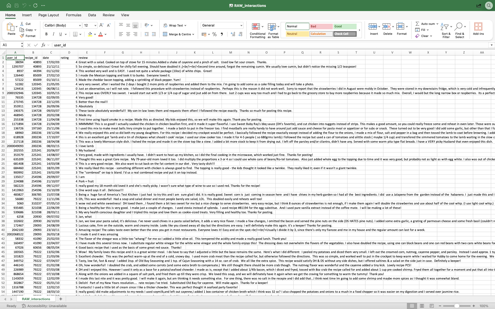
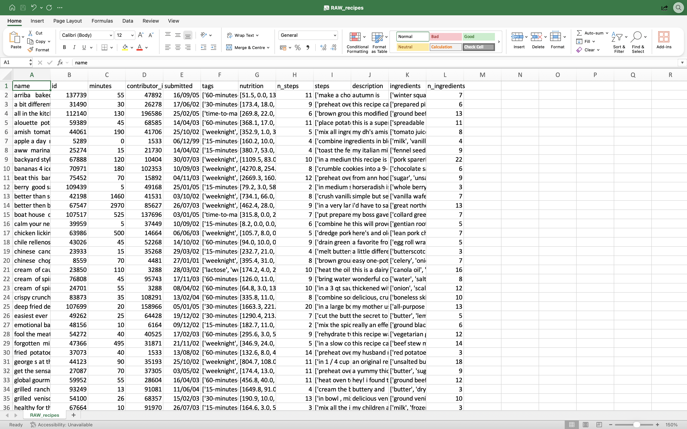

# Rate My Recipe – Food.com Recipe Ranking System

A Python-based data analysis and recipe ranking project using the **Food.com Recipes and User Interactions** dataset. This project explores recipe characteristics, analyzes user ratings, compares three ranking methods, and provides an interactive Streamlit application for discovering and exploring recipes.

## 1. Project Overview

A recipe with a 5.0 average rating is not necessarily better supported by user feedback than a recipe with a 4.8 average rating. For example, a recipe rated 5.0 by two users may be less reliable than one rated 4.8 by hundreds of users.

The objective of this project is to investigate this problem by comparing different approaches to recipe ranking.

The project includes:

- Data exploration and quality assessment.
- Data cleaning and preprocessing.
- Exploratory data analysis (EDA).
- Recipe-level rating statistics.
- Comparison of three recipe ranking methods.
- An interactive Streamlit application.

## 2. Dataset Source and Description

**Dataset:** [Food.com Recipes and User Interactions – Kaggle](https://www.kaggle.com/datasets/shuyangli94/food-com-recipes-and-user-interactions)

The dataset contains two main CSV files.

### Recipes dataset – `RAW_recipes.csv`

Contains recipe-level information, including:

- Recipe ID and name.
- Cooking time.
- Contributor ID and submission date.
- Tags and description.
- Ingredients and cooking instructions.
- Nutritional information.
- Number of ingredients and steps.

Original dataset size: **231,637 recipes and 12 columns**.

### User interactions dataset – `RAW_interactions.csv`

Contains user feedback and rating information, including:

- User ID.
- Recipe ID.
- Interaction date.
- Rating.
- Written review.

Original dataset size: **1,132,367 interactions and 5 columns**.

### Dataset screenshots

The following screenshots provide an overview of the original dataset files and their structure.

**Recipes dataset**



**User interactions dataset**



### Representative Sample Datasets

This repository includes two representative sample CSV files in `data/sample/` to demonstrate the structure and contents of the original Food.com dataset without distributing the complete raw datasets.

| Sample file | Rows | Columns | File size |
|---|---:|---:|---:|
| `sample_recipes.csv` | 1,254 | 12 | 1.58 MB |
| `sample_interactions.csv` | 79,721 | 5 | 22.61 MB |

**Sample selection methodology**

- Selected 250 recipes from each of five groups based on the number of valid ratings (1–5).
- Included additional recipes to cover all rating values (0–5), missing reviews, and recipes without valid ratings.
- Deliberately included examples of missing descriptions, zero cooking time, extremely high cooking time, and empty cooking instructions.
- Retained every original interaction record for each selected recipe.

**Data integrity**

The sample datasets were validated against the original CSV files. All 1,254 selected recipe IDs are unique, every interaction refers to a recipe in the sample, and all original interaction records for the selected recipes are preserved. No interaction-count mismatches were found.

**Important:** This is a balanced demonstration sample, not a statistically proportional representation of the complete Food.com dataset. The complete raw datasets are not included in this repository.

### Data handling

The original CSV files are large and are not included in this GitHub repository.

They can be downloaded directly from the Kaggle source. The original files are kept locally in `data/raw/`, while processed data is stored in `data/processed/`.

Representative sample datasets will also be provided in the repository after validation. These samples are intended to help reviewers inspect the data structure and demonstrate the project without downloading the complete original datasets.

## 3. Data Cleaning and Preprocessing

Data preparation is implemented in reusable functions in `src/data_processing.py` and documented in the second Jupyter notebook.

The preprocessing workflow includes:

- Removing the recipe record with a missing or blank recipe name.
- Handling missing descriptions without unnecessarily removing recipes.
- Converting cooking time values of zero into missing values.
- Converting submission dates into datetime format.
- Extracting nutritional information into separate numeric columns.
- Parsing tags, ingredients, and cooking instructions into Python lists.
- Creating additional recipe features, including ingredient count, tag count, and step count.
- Cleaning interaction dates while preserving the original rating and review records.

The processed recipe dataset contains **231,636 recipes and 21 columns**.

## 4. Recipe Rating Analysis

The original interaction dataset contains ratings from 0 to 5.

For ranking calculations, ratings of 1–5 are considered valid. A rating of 0 is excluded because it represents an interaction without a valid numerical rating in this analysis.

| Metric | Result |
|---|---:|
| Total interactions | 1,132,367 |
| Valid ratings (1–5) | 1,071,520 |
| Zero ratings excluded | 60,847 |
| Recipes with valid ratings | 226,590 |
| Average ratings per recipe | 4.73 |
| Median ratings per recipe | 2 |

The global average of all valid individual ratings is approximately **4.6615**.

These statistics help explain why ranking recipes using average ratings alone can be misleading: most recipes have relatively few ratings.

## 5. Recipe Ranking Methodology

Three ranking methods are implemented in `src/ranking.py`.

### Method 1 – Simple Average Rating

Ranks recipes according to their average user rating.

Advantages:
- Easy to understand and interpret.
- Directly reflects the average rating received.

Limitation:
- Recipes with very few ratings can appear at the top with potentially unreliable averages.

When average ratings are equal, rating count and recipe ID are used as tie-breakers.

### Method 2 – Weighted Average Rating

Uses both the recipe's average rating and the global average rating.

\[
W = \frac{n\bar R + mC}{n+m}
\]

Where:

- \(n\): Number of valid ratings for the recipe.
- \(\bar R\): Average rating of the recipe.
- \(m\): Manually selected prior strength (10).
- \(C\): Global average rating.

This method reduces the influence of unusually high or low averages based on very few ratings.

### Method 3 – Empirical Bayesian Ranking

Uses the same shrinkage formula but estimates the prior strength statistically using the method of moments.

The estimated prior strength is approximately **7**, and the global prior mean is approximately **4.6615**.

This approach provides a data-driven alternative to manually choosing the prior strength.

### Why compare these methods?

The comparison helps investigate how the choice of ranking method affects the ordering of recipes, particularly those with relatively few ratings.

The project does not assume that one method is universally superior. Instead, it examines the differences and trade-offs between the methods.

## 6. Key Findings

The analysis produced several observations:

- Most recipes have relatively few user ratings.
- The median number of valid ratings per recipe is only 2.
- Average ratings are concentrated toward the higher end of the rating scale.
- Rating count and average rating have a very weak relationship in the overall dataset.
- Ranking methods that incorporate rating count can change the ordering of recipes.

### Top 20 ranking overlap

| Comparison | Common recipes |
|---|---:|
| Simple Average vs Weighted Average | 10 out of 20 |
| Simple Average vs Bayesian | 12 out of 20 |
| Weighted Average vs Bayesian | 18 out of 20 |

These results demonstrate that ranking methodology can meaningfully influence which recipes appear among the highest-ranked results.

## 7. Streamlit Application

The project includes an interactive application built with Streamlit.

The application provides four main sections:

1. **Dataset Overview**
   - Displays dataset statistics.
   - Shows the total number of recipes and recipes with ratings.
   - Provides an overview of recipe rating information.

2. **Recipe Ranking**
   - Allows users to select Simple Average, Weighted Average, or Empirical Bayesian ranking.
   - Allows users to choose the number of top-ranked recipes to display.
   - Displays ranking scores and rating counts.

3. **Recipe Explorer**
   - Search recipes by name.
   - Filter by cooking time.
   - Filter by minimum average rating.
   - Filter by number of ingredients.

4. **Recipe Details**
   - Search and select individual recipes.
   - View cooking information and rating statistics.
   - Explore ingredients and cooking instructions.

## 8. Project Structure

```text
food-recipe-ranking/
│
├── app/
│   └── streamlit_app.py
│
├── data/
│   ├── raw/                 # Original datasets (not tracked)
│   ├── processed/           # Processed datasets (not tracked)
│   └── sample/              # Representative sample datasets
│
├── docs/
│   └── ranking_methodology.md
│
├── notebooks/
│   ├── 01_data_exploration.ipynb
│   ├── 02_data_cleaning_preprocessing.ipynb
│   └── 03_exploratory_data_analysis.ipynb
│
├── src/
│   ├── data_processing.py
│   ├── ranking.py
│   └── compare_ranking_methods.py
│
├── .gitignore
├── requirements.txt
└── README.md
```

## 9. Technologies Used

- **Python** – Core programming language.
- **Pandas** – Data manipulation and analysis.
- **NumPy** – Numerical calculations.
- **Matplotlib** – Data visualization.
- **Seaborn** – Statistical visualization.
- **Streamlit** – Interactive web application.
- **Jupyter Notebooks** – Data exploration, preprocessing, and EDA.
- **Git and GitHub** – Version control and project hosting.

## 10. Installation and Execution

### Step 1 – Clone the repository

```bash
git clone https://github.com/venudatta67/food-recipe-ranking.git

cd food-recipe-ranking
```

### Step 2 – Create and activate a virtual environment

```bash
python3 -m venv .venv
```

On macOS or Linux:

```bash
source .venv/bin/activate
```

### Step 3 – Install dependencies

```bash
python -m pip install -r requirements.txt
```

### Step 4 – Download the original datasets

Download the two CSV files from the Kaggle dataset source and place them in:

```text
data/raw/
├── RAW_recipes.csv
└── RAW_interactions.csv
```

### Step 5 – Prepare the processed recipe dataset

Open and execute the notebooks in the following order:

1. `01_data_exploration.ipynb`
2. `02_data_cleaning_preprocessing.ipynb`
3. `03_exploratory_data_analysis.ipynb`

The second notebook creates the processed recipe dataset required by the application.

### Step 6 – Run the Streamlit application

From the project root:

```bash
streamlit run app/streamlit_app.py
```

The application will open in your web browser.

**Note:** The current application uses the processed recipe dataset and original interaction CSV at the paths specified in its source code. The original datasets or a compatible configured sample-data setup are therefore required to run it.

## 11. Limitations

- The dataset contains a large proportion of recipes with relatively few ratings.
- Ratings of zero are excluded from numerical ranking calculations.
- The weighted-average prior strength is manually selected.
- Empirical Bayesian ranking depends on the statistical assumptions used to estimate prior strength.
- The ranking methods evaluate historical user ratings; they do not predict individual user preferences.
- Results are based on the available Food.com dataset and may not represent all users or recipes.

## 12. Author and Repository

**Project:** Rate My Recipe – Food.com Recipe Ranking System

**GitHub repository:**
https://github.com/venudatta67/food-recipe-ranking

**Project type:** Individual Python data analysis and application development project.